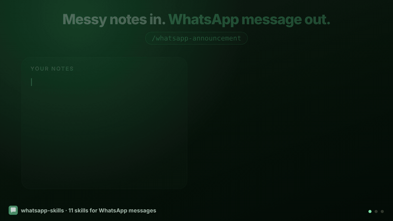

<p align="center">
  
</p>

<h1 align="center">WhatsApp Skills</h1>

<p align="center">
  <b>Give the context once. Get the WhatsApp message to paste.</b><br>
  11 open-source Agent Skills for Claude, ChatGPT/Codex and any agent that reads <code>SKILL.md</code>.
</p>

<p align="center">
  
  
  
  
  
</p>

<p align="center">
  
</p>

---

You know the situation. Your manager needs to know you're late, the society group
needs the water-cut notice, 200 relatives need the wedding schedule with three
venues and three map links. You have every detail in your head, and you're tired
of explaining it to an AI, then fixing the `**stars**` and the wrong weekday it
gives back.

These skills fix that. Dump the context in your own words, as messy as you like.
You get back **the final message**: the right tone for the person, WhatsApp
formatting that actually renders, every date, link and number exactly as you
gave them, and nothing invented.

```text
you:  msg to manager Kavita, fever since last night, won't come today, client deck
      is 90% done, Rahul can present at 3 if needed, on phone for urgent stuff
```

```text
Hi Kavita, I've had a fever since last night so I won't make it in today.

The client deck is 90% done and in the shared folder. Rahul can present it at 3 if needed, I've briefed him.

I'm on my phone for anything urgent.
```

**Draft-only, by design.** Nothing here connects to WhatsApp, sends messages or
automates anything. You copy, you paste, you send. No accounts, no API keys.

## What it handles

| Skill | Use it for |
|---|---|
| **`whatsapp-message`** | Any 1:1 or small-chat message: boss, HR, recruiter, client, landlord, a new contact, friends, family. Leave, late, follow-ups, payment nudges, apologies, congratulations, condolences. Voice-note scripts too. |
| **`whatsapp-reply`** | Paste what you received (or a screenshot) and say what you want: yes, no, later, a counter-offer. Answers every question they asked. Spots scams instead of replying to them. |
| **`whatsapp-announcement`** | Group, community and broadcast notices: meetings, schedule changes, alerts, fee dues, PTMs, study material with links, holidays, rules, fundraisers, job openings, urgent blood or help requests, minutes, stand-ups, buy-sell-rent posts, event recaps. |
| **`whatsapp-invitation`** | Weddings (every function), birthdays, griha pravesh, poojas, baby showers, reunions, office parties, plus save-the-date, reminder and thank-you messages. English, Hinglish, Hindi or bilingual. |
| **`whatsapp-promotion`** | Offers, festive sales, launches, new arrivals, courses and webinars, service reminders, review and referral asks, listings, plus order confirmed, shipped and delivered, payment received or due, cart reminders and broadcast welcomes. Honest terms, one call to action, opt-out line. |
| **`whatsapp-status`** | Text status (700-character limit), photo/video captions, and 2-5 status slides. |
| **`whatsapp-channel`** | Channel posts and series ("Day 7/30"), roundups, welcome posts, polls, with consistent numbering and format. |
| **`whatsapp-formatter`** | Turn ChatGPT/Claude Markdown, emails or notes into WhatsApp formatting without rewriting them. Fix typos in your voice. Or just check a message before you send it. |
| **`whatsapp-redact`** | Mask phone numbers, emails, UPI and bank details, cards, OTPs, Aadhaar, PAN, names and addresses before you forward a chat, warn a group about a scam, or paste into an AI. Checksum-validated detection, consistent stand-ins like `Person A` and `[phone 1]`. |
| **`whatsapp-setup`** | The text you write once: WhatsApp Business description, greeting and away messages, quick replies, catalog items, labels, your About line, and group, community and channel names, descriptions and rules. |
| **`whatsapp-catchup`** | Paste or export a busy group chat and get what you missed: decisions, dates, what's asked of you, links, open questions. Then the minutes or recap to post back. |

170 everyday scenarios and the skill that handles each: **[docs/SCENARIOS.md](docs/SCENARIOS.md)**.

## Install

**Claude (claude.ai web and Claude Desktop):** Customize → **Plugins** → **Add** → *Add marketplace* →
*Add from a repository* → `withrvr/whatsapp-skills` → sync. Then open **Discover**, find
**whatsapp-skills** and click **+**. It now shows under **Yours**.

**Claude Code**

```
/plugin marketplace add withrvr/whatsapp-skills
/plugin install whatsapp-skills@whatsapp-skills
```

**Codex CLI**

```bash
codex plugin marketplace add withrvr/whatsapp-skills
```

```bash
codex plugin add whatsapp-skills@whatsapp-skills
```

**Any agent that reads skills** (Claude Code, Codex, Cursor, Gemini CLI and others):

```bash
npx skills add withrvr/whatsapp-skills
```

ChatGPT, single-skill zip uploads, clone-and-open, and agents without skill support:
**[docs/INSTALL.md](docs/INSTALL.md)**.

## Use it

Just describe the situation. Mention WhatsApp (or a group, status or channel) and the right skill picks itself up.

> *society group alert: no water tomorrow 10am to 5pm, tank cleaning. store water tonight. contact maintenance 022 2654 1100. from Rakesh, secretary*

> *reply to this from my landlord: "rent increase 10% from Jan". say I can do 5%, been here 3 years, always paid on time. polite*

> *wedding invite for Ananya & Rohit, mehendi fri 11 dec 4pm at home, sangeet same day 8pm Clarks Amer, wedding sat 12 dec Leela Palace Jaipur, map links …, hindi + english*

Add any dial in plain words: **short / mid / detailed**, **formal / casual / funny / urgent**,
**no formatting / proper formatting**, **no emoji / more emoji**, **Hinglish / Hindi / Tamil / bilingual**.
After a draft, one word adjusts it: *shorter*, *more formal*, *in Hindi*, *3 options*.

In Claude Code you can also call a skill directly: `/whatsapp-announcement <your notes>`
(as a plugin: `/whatsapp-skills:whatsapp-announcement`).

More on briefing, dials and standing preferences: **[docs/USAGE.md](docs/USAGE.md)**.

## Why the output is right

- **WhatsApp formatting, not Markdown.** `*bold*`, `_italic_`, `~strike~`, lists and quotes that render. Never `**bold**`, `# headings`, `[links](…)` or tables, the habits that show up as junk in a chat.
- **Facts are copied, never invented.** Links character for character, numbers, names and amounts exact. If something essential is missing you get a `[placeholder]` and a note, not a guess.
- **Weekday ↔ date checking.** "Friday, 7 Nov" when 7 Nov is a Saturday gets caught and flagged.
- **Built for the chat bubble.** The point in the first two lines, short blocks, labeled logistics (📅 ⏰ 📍), links that get a preview, captions that work with media, notes on re-tagging `@mentions`.
- **A checker in every skill.** [`wa_lint.py`](shared/scripts/wa_lint.py) (Python standard library only) checks each draft before it's handed over: Markdown leaks, markers that won't render, broken links, any em or en dash, weekday/date mismatches, the 700-character status limit, placeholders, chain-message patterns, card/Aadhaar/PAN/OTP numbers. `--fix` converts Markdown to WhatsApp; `--redact` masks sensitive values.

## Voice rules

Every skill follows these automatically, and the built-in checker enforces the
mechanical ones before a message reaches you:

1. **No em dashes (—) or en dashes (–). Ever.** They're the quickest giveaway of
   AI text in a chat. Commas, full stops, colons, "to" and new lines instead.
2. **Names capitalised exactly as given.** "priya" in your notes becomes "Priya" in the message.
3. **No AI or email vocabulary:** leverage, streamline, delve, foster, robust,
   "I hope this message finds you well", "Kindly do the needful", "Please find attached".
4. **Specific beats vague.** "₹14,200" not "a big amount", "Thu, 5 Nov, 11 am" not "later this week".
5. **One point per message.** One ask, one piece of news.
6. **Length fits the message type.** A reply is a few lines, a status is one glance,
   an announcement fits one phone screen.
7. **Sounds typed, not written.** Short sentences, contractions, no "Furthermore", no semicolons in casual chats.
8. **Emoji are labels, not decoration**, and never more than your audience uses.
9. **No shouting** (whole lines in capitals) and no hashtags (they don't work on WhatsApp).
10. **Sign-off is just your name on the last line.** Not "- Name", which WhatsApp turns into a bullet.

## Languages

The skills are written and tested in **English**, which is the main focus. Ask
for any other language and the model writes it natively: Hinglish, Hindi,
Marathi, Tamil, Telugu, Bengali, Gujarati, Urdu, Arabic, Spanish, Portuguese,
Indonesian and more. The same rules apply in every language: exact facts,
WhatsApp formatting, no dashes. Examples in other languages are especially
welcome as contributions ([CONTRIBUTING.md](CONTRIBUTING.md)).

## Tested against a real model

Every skill ships evals in the [Agent Skills format](https://agentskills.io/skill-creation/evaluating-skills)
(`skills/*/evals/evals.json`): 33 realistic prompts, including traps like a
weekday that doesn't match its date, a request for fake "only 2 hours left"
urgency, a "Hi Mom, new number" scam, a venue that changes halfway through a
chat, a suggestion that must not be reported as a decision, Devanagari output,
Markdown input, and phone numbers that must be masked. `scripts/run_evals.py`
runs each prompt through Claude Code with and without the skills and grades the
output with deterministic checks.

| Out of 33 test requests | Plain AI | With the skills |
|---|---|---|
| Messages with `**stars**` showing instead of bold | 25 | **0** |
| Messages with em or en dashes | 10 | **0** |
| All automated checks passed (formatting, dates, facts, safety) | 60% | **99%** |

Same model and same requests both times; only the skills changed. Without them
the model also left a phone number visible when asked to hide them, and answered
"write my status" with 240 to 880 characters of options instead of one status.
With the skills, a matching skill picked itself up in 32 of 33 runs without being
named; the other was a one-line typo fix the model did directly.

## Repository layout

```
skills/<name>/            one folder per skill, self-contained (spec-compliant)
  SKILL.md                instructions + shared core rules
  references/             playbooks, examples, shared formatting/dials/rules
  scripts/wa_lint.py      the pre-send checker and sensitive-data masker
  evals/evals.json        test prompts, assertions and checks
skills/whatsapp-catchup/scripts/wa_chat.py   chat-export parser
shared/                   single source for everything copied into skills
scripts/                  sync, validate, evals, zip builder
docs/                     install, usage, scenario catalog
.claude-plugin/           Claude plugin + marketplace manifests
.codex-plugin/, .agents/  OpenAI (Codex / ChatGPT) plugin + marketplace
.claude/skills/           symlinks so Claude Code finds the skills on clone
tests/                    offline test suite
```

## Development

```bash
pip install -r requirements-dev.txt
```

```bash
python3 scripts/sync.py && python3 scripts/validate.py && python3 -m unittest discover -s tests
```

```bash
python3 scripts/run_evals.py --baseline
```

Edit shared content in `shared/`, never the generated copies in `skills/*/references/`.
Contributions, especially new scenarios and languages, are welcome:
**[CONTRIBUTING.md](CONTRIBUTING.md)**.

## Privacy

The skills are instructions and a local script. They make no network calls and
store nothing. Your messages go only where your AI app already sends your chats.

---

MIT licensed. Not affiliated with, endorsed by or sponsored by WhatsApp or Meta.
WhatsApp is a trademark of WhatsApp LLC.
